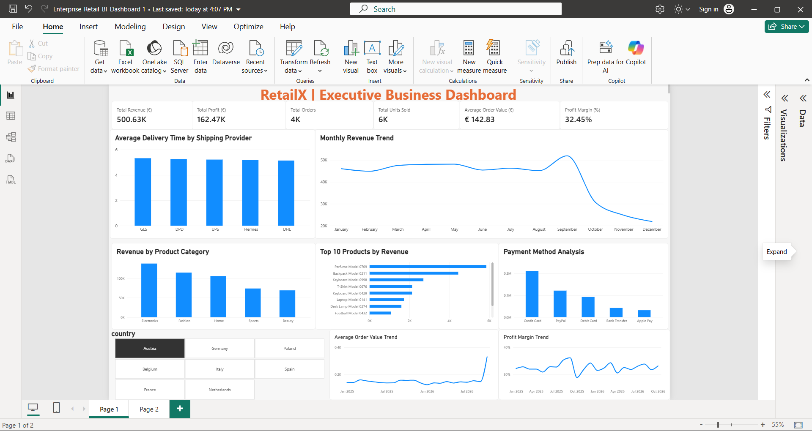

# RetailX Enterprise Data Engineering & Business Intelligence Platform

## Project Overview

RetailX is an end-to-end data engineering and business intelligence project built to transform retail data into actionable business insights.

The project uses Python for data cleaning and ETL, PostgreSQL for data warehousing and SQL analytics, and Power BI for interactive dashboards.

## Technologies Used

- Python
- Pandas
- PostgreSQL
- SQL
- Power BI
- Git and GitHub

## Data Pipeline

CSV Files → Python Data Cleaning → PostgreSQL Data Warehouse → SQL Analytics → Power BI Dashboard

## Power BI Dashboard

The dashboard provides insights into:

- Total revenue and profit
- Monthly revenue trends
- Revenue by product category
- Top 10 products by revenue
- Payment method analysis
- Average delivery time by shipping provider
- Average order value trends
- Profit margin trends
- Country-level analysis

## Project Structure

- `Data/` — Raw retail datasets
- `Cleaned_Data/` — Cleaned datasets
- `ETL/` — Python ETL scripts and SQL files
- `screenshots/` — Power BI dashboard screenshot

## Key Skills Demonstrated

- Data cleaning and transformation
- ETL pipeline development
- PostgreSQL database integration
- SQL analytics and views
- Data warehouse design
- Power BI dashboard development
- Git and GitHub version control

## Author

Data Science Master's student | Aspiring Data Engineer and BI Developer